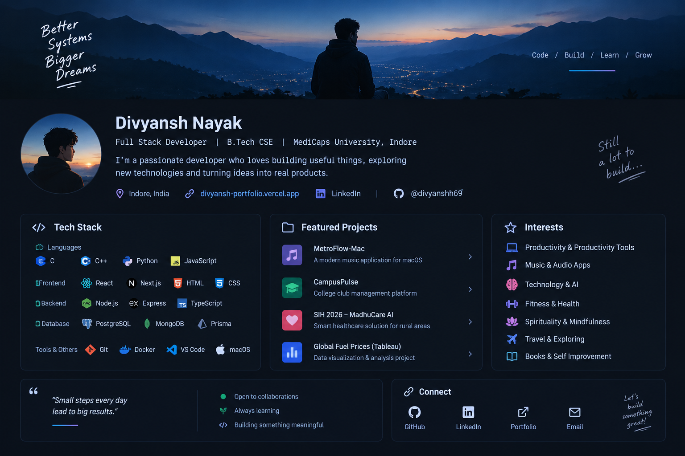

 

# Hey, I'm Divyansh Nayak 👋

### Developer • Builder • Learner

I'm a **B.Tech Computer Science & Engineering student at Medi-Caps University, Indore**, passionate about building useful applications, exploring new technologies, and turning ideas into real products.

- 🔭 Currently building projects and improving my development skills
- 🌱 Exploring **Full-Stack Development, AI, and modern application development**
- 💡 I enjoy creating practical tools that solve real problems
- 🚀 Building applications that help people learn, connect, and grow

---

## 🚀 Featured Projects

### 🤝 SkillSync — Skill-Based Collaboration Platform

A platform designed to help people connect, collaborate, and build projects based on their skills and interests.

**Focus:** Collaboration • Skill Discovery • Project Building • Modern Web Development

### 🎵 MetroFlow — Modern Music Experience for macOS

A modern music application designed to provide a clean and focused listening experience on macOS.

**Focus:** Music discovery • Playback • Library management • Modern UI

### 🎓 CampusPulse — College Club Management Platform

A platform designed to help manage college clubs, members, events, and related activities.

**Tech:** Node.js • Express • TypeScript • PostgreSQL • Prisma

### 🏥 MadhuCare AI — SIH 2026

A healthcare-focused project concept aimed at supporting early screening and improving healthcare accessibility in rural areas.

**Focus:** AI • Healthcare • Accessibility

---

## 🛠️ Tech Stack

### Languages

  

### Frontend

  

### Backend & Database

  

### Tools

  

---

## 📌 What I'm Exploring

I enjoy working on projects that combine **technology, creativity, and practical problem-solving**.

Currently interested in:

- 💻 Full-Stack Application Development
- 🤖 Artificial Intelligence & Machine Learning
- 🖥️ Desktop & Web Application Development
- ☁️ Backend, Databases & Cloud Technologies
- 🚀 Turning ideas into real products

---

## 📊 GitHub Stats

---

## 🌐 Connect With Me

&nbsp;&nbsp;

&nbsp;&nbsp;

---

### 💭 *"Small steps every day lead to big results."*

**Code • Create • Innovate**

